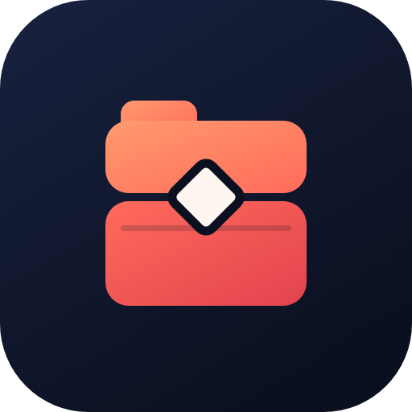

# Coffre

> Tout ton sujet, au même endroit.



Un seul endroit pour ranger, par sujet : liens (reels Instagram/Facebook, YouTube, articles), notes, vocaux, documents, images, vidéos, et favoris importés depuis le navigateur.

- `mobile/` : application Android + iPhone (Expo). Voir [mobile/README.md](mobile/README.md).
- `web/` : **Coffre Web** (Vite + React + TypeScript), qui affiche le Coffre du téléphone après un scan de QR code.
- `supabase/schema.sql` : comptes, signalements et données de l'ancienne version cloud. Voir [SETUP.md](SETUP.md).

## Où sont les données (depuis la v0.5.0 de l'app mobile)

Comme WhatsApp, **le contenu vit sur le téléphone** (`<documents>/coffre/<userId>/library.json` + `files/`), et la sauvegarde se fait dans le Google Drive de la personne. Supabase ne sert plus qu'au compte (connexion), aux signalements et à la suppression de compte.

- Au premier lancement de la v0.5.0, l'app copie sur le téléphone les dossiers, liens, notes et fichiers de l'ancienne version cloud (rien n'est supprimé du cloud).
- Les tâches et habitudes ont été retirées de l'app (elles feront une app séparée) ; leurs données restent dans Supabase.

## Coffre PC et Coffre Web (QR code, comme WhatsApp Web)

L'ordinateur garde **sa propre copie** de ton Coffre (dossiers, liens, notes et fichiers), stockée localement. Il fonctionne donc sans le téléphone.
Le bouton **Synchroniser** compare les deux copies et échange seulement les différences, dans les deux sens (le plus récent gagne, une suppression se propage).
Rien n'est envoyé tant que tu n'appuies pas.

1. Le site (ou l'application Windows `desktop/`) crée une paire de clés x25519 et un canal aléatoire, et les affiche dans un QR code.
2. L'app (Réglages → Coffre Web → Connecter un appareil) scanne le code, crée sa propre paire de clés et envoie sa clé publique.
3. Les deux calculent la même clé secrète (x25519 + HKDF-SHA256). Chaque message est ensuite chiffré (XChaCha20-Poly1305) et passe par un relais **Supabase Realtime (broadcast)**, qui ne voit que des données illisibles et ne garde rien.

Le protocole est dans `web/src/link/protocol.ts` et les règles de synchronisation dans `web/src/link/sync.ts` : copies identiques de `mobile/src/lib/link/` (vérifié par `node scripts/check-link-protocol.mjs`).
L'application Windows est décrite dans [desktop/README.md](desktop/README.md).

## Lancer le site

```bash
cd web
npm install
npm run dev      # http://localhost:5173
npm run build    # vérification des types + build de production dans dist/
```

## Fonctions

- Dossiers et sous-dossiers par sujet, avec icône
- Liens avec détection de plateforme (Instagram Reel, vidéo Facebook, YouTube, TikTok, X…) et miniature YouTube
- Notes, vocaux, photos, vidéos et documents
- Partage direct depuis les autres apps vers Coffre (Android / iPhone)
- Recherche globale et filtres par type
- Données sur le téléphone, sauvegarde automatique dans Google Drive façon WhatsApp (dossier « Coffre » visible), restauration
- Coffre PC / Coffre Web : copie locale du Coffre sur l'ordinateur, synchronisée avec le téléphone par un bouton, après un scan de QR code, chiffré de bout en bout. Connexion Google sur le site, 7 jours d'essai gratuit puis abonnement vendu sur le site (voir [SETUP.md](SETUP.md)) ; le téléphone vérifie lui aussi l'abonnement
- Import des favoris du navigateur depuis le site (fichier HTML exporté depuis Chrome/Edge/Firefox/Safari)
- Connexion avec Google uniquement (pas de mot de passe, pas d'email de confirmation)
- Signalement de problèmes et suppression de compte depuis l'app
